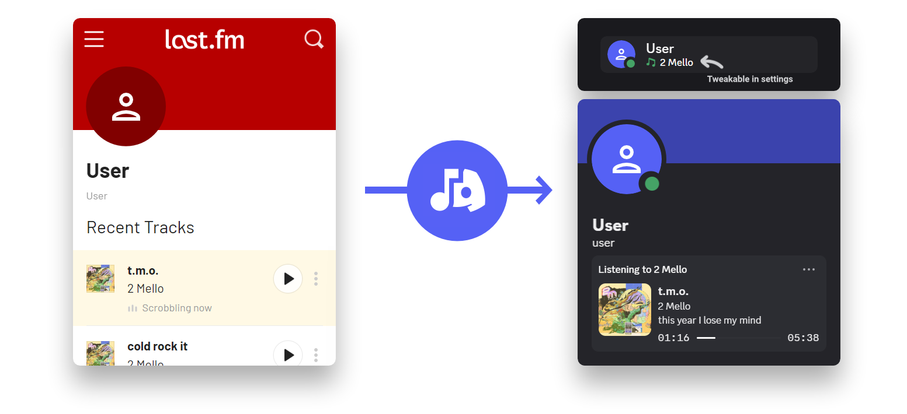
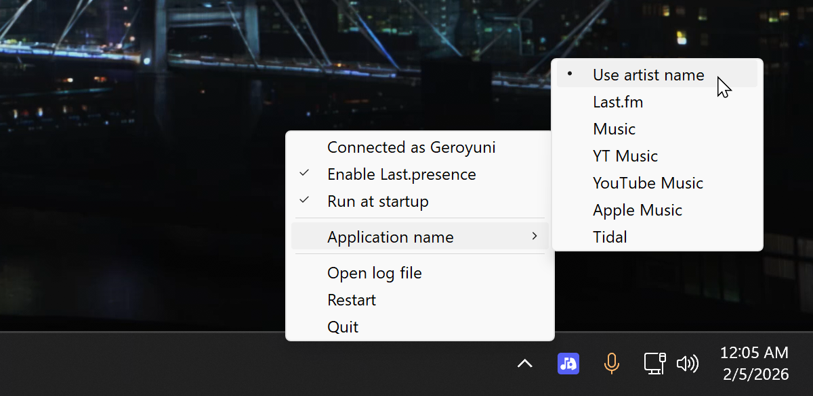

> [!WARNING]
> Last.fm [just announced they'll make API keys paid](https://support.last.fm/t/api-keys-will-require-pro-from-1st-december/121030), so this app will stop working December 1st. These two points mean I'll likely archive the project rather than pay for the key:
> - I believe [Vencord](https://vencord.dev/)'s MusicRichPresence plugin is most of the way there for what my app does, barring maybe the song duration progress bar if I recall. If someone who makes the plugin is willing to pay then it'd be the go-to. Alternatively, it also supports Listenbrainz. Vencord is already a must to de-enshittify Discord, so I recommend using it along with the plugin. Recommended plugin settings: Status Name '{artist}', Use Listening Status 'ON', and remove any Last.fm branding 
> - I'm personally not fond of Last.fm's lack of notable updates, and Web Scrobbler appears to have low community interest for maintenance such that YTMusic has been broken in it for over a year. This has made me very uninterested in Last.fm

# Last.presence
This app takes your current song in Last.fm (a website which can be made to track any streaming service you use) and puts it in your Discord profile, using Discord Rich Presence (RPC).

Last.fm is a website that lets you track what you listen to, sort of like a Spotify Wrapped, but available at any time of the year. It's versatile in that it can be made to track listens from anywhere (with extensions like [Web Scrobbler](https://web-scrobbler.com/) on PC, or phone apps like [Pano Scrobbler](https://play.google.com/store/apps/details?id=com.arn.scrobble)).

## How to install
Only available for Windows, because it's what I use.

### Standalone executable (recommended)
[Download the executable](https://github.com/Geroyuni/Last.presence/releases/latest), put in its own folder and run. You are likely to need to skip Windows warnings and whitelist the file in your anti-virus, because the file isn't signed.

### Manual build (mainly for development)
Get [Python 3.10+](https://www.python.org/downloads/) and [upx (optional but smaller file, used by pyinstaller)](https://github.com/upx/upx/releases/tag/v4.2.4). Ensure they're all in your environment path.
- Either clone the repository with `git clone https://github.com/Geroyuni/Last.presence.git` or [manually download](https://github.com/Geroyuni/Last.presence/archive/refs/heads/main.zip) and unzip into a folder
- Run the included `build.bat` in the folder for building

## Interacting with the program
At the start, the program will request your Last.fm username and API. After that, it runs as a small icon in the tray bar, at the bottom right. You can right-click it to change settings (e.g. change status name, make it run at startup), or open the log file if there are any issues.

